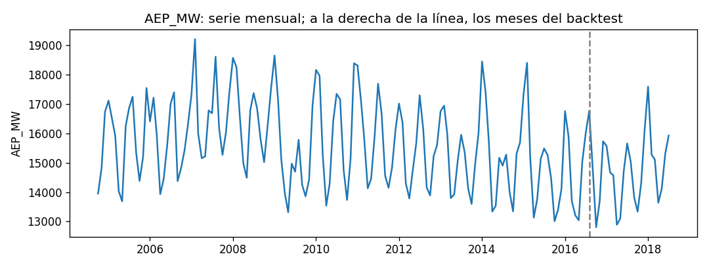
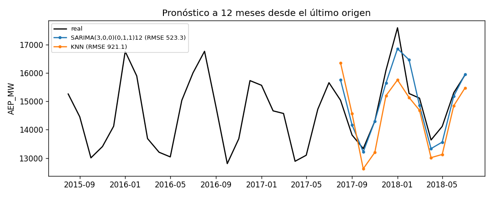

# Informe del miniproyecto 2

## 1. La serie y el modelo a superar

La serie es la del miniproyecto 1: la carga eléctrica media por hora de cada
mes en la zona de American Electric Power (AEP), dentro de la red PJM de
Estados Unidos, en MW. Va de octubre de 2004 a julio de 2018, con 166 meses y
ningún hueco.

Agosto de 2018 se descartó al agregar las horas porque solo tenía 49, dos
días de un mes de 31. Borrar un mes tiene un costo: si estuviera en medio de
la serie, dos filas seguidas quedarían separadas por dos meses, el índice
dejaría de ser mensual y `shift(12)` ya no apuntaría al mismo mes del año
anterior. Aquí no pasa porque agosto de 2018 era el último mes: quitarlo
acorta la serie, pero los 166 meses que quedan van uno detrás de otro.
`preparar` lo comprueba comparando el índice con
`pd.date_range(inicio, periods=166, freq="MS")` y lanza un error si falta
algún mes. El guion imprime *"espaciado mensual: 166 meses seguidos, de
2004-10 a 2018-07, sin saltos"*. Si el mes incompleto hubiera quedado en
medio, lo correcto habría sido dejarlo vacío e interpolarlo, no borrarlo.

`preparar` repite la decisión del miniproyecto 1 sobre los atípicos: compara
cada mes con el promedio del mismo mes un año antes y un año después. Julio
de 2009 queda a −3,5 desviaciones (14 697 MW frente a 17 360) y es el único
que pasa de 3. Se conserva porque es demanda real, no un error de medición.

El modelo a superar es el $\text{SARIMA}(3, 0, 0)(0, 1, 1)_{12}$:

$$(1 - \phi_1 B - \phi_2 B^2 - \phi_3 B^3)(1 - B^{12})\,y_t = (1 + \Theta_1 B^{12})\,\varepsilon_t,$$

con $B^k y_t = y_{t-k}$. Es el que sale de la lectura de la ACF y la PACF del
miniproyecto 1. ADF dio $d = 0$ y $D = 1$. Después de `diff(12)`, la PACF
tiene picos en los rezagos 1 y 3, de ahí $p = 3$. En la parte estacional, la
ACF tiene un pico aislado en el rezago 12 (−0,27) y la PACF decae en 12, 24 y
36 (−0,32, −0,20 y −0,13), que es la forma de un MA estacional de orden 1:
$Q = 1$ y $P = 0$.

En el miniproyecto 1 la rejilla por AIC eligió $P = 1$, el
$\text{SARIMA}(3, 0, 0)(1, 1, 1)_{12}$, con AIC 335,85 frente a 339,89, y ese
fue el modelo de la tabla. La realimentación señaló que $P = 1$ no coincide
con nuestra propia lectura de la ACF. Aquí usamos el modelo de esa lectura.
No lo elegimos por su error de prueba: la lectura de la ACF es anterior al
*backtest* y es la misma que escribimos en el miniproyecto 1.

Con toda la serie, en GW, los coeficientes son $\phi_1 = 0{,}427$,
$\phi_2 = 0{,}046$, $\phi_3 = 0{,}241$ y $\Theta_1 = -0{,}765$, con AIC 339,89.
Se ajusta sobre la serie en GW (`ESCALA = 1000`) con la clase `ARIMA` de
`statsmodels`, y el pronóstico vuelve a MW. En este *backtest* da RMSE
753,50 MW, MAE 586,96 MW y MAPE 3,99 %; en el contraste del miniproyecto 1
había dado 753,51, 586,96 y 3,99. El guion también pasa por el *backtest* el
de $P = 1$, solo como contraste y fuera de `metricas.csv`: RMSE 770,98.

## 2. La tabla supervisada

Cada fila es un mes $t$ y tiene 15 columnas, todas con datos hasta $t-1$:

| Columna | Fórmula | Qué aporta |
|---|---|---|
| `rezago_k`, $k = 1, \dots, 12$ | $z_{t-k} = y_{t-k} - y_{t-k-12}$ | la diferencia interanual de hace $k$ meses; `rezago_12` es la del mismo mes del año anterior |
| `mes` | mes del calendario de $t$, de 1 a 12 | se conoce de antemano |
| `media_3` | $\tfrac{1}{3}(z_{t-1} + z_{t-2} + z_{t-3})$ | el nivel reciente, suavizado |
| `desv_3` | desviación estándar de $z_{t-1}, z_{t-2}, z_{t-3}$ | qué tan estable estuvo el último trimestre |

Las dos ventanas se calculan sobre `z.shift(1)`, la serie corrida un mes,
para que la fila $t$ nunca incluya $z_t$.

Los modelos aprenden la diferencia con el mismo mes del año anterior,
`OBJETIVO = "dif12"`:

$$z_t = y_t - y_{t-12}, \qquad \hat y_t = y_{t-12} + \hat z_t.$$

La razón es el miniproyecto 1: ADF no rechazó la raíz unitaria en la serie
original (valor p 0,0858) y sí en `diff(12)` (0,0016), y de ahí salieron
$d = 0$ y $D = 1$. Es la misma decisión del SARIMA y de los talleres 3 a 5.
De los 166 meses quedan 142 filas completas, desde 2006-10: 12 se pierden en
la diferencia y 12 en `rezago_12`.

`comprobar_sin_fuga` suma 1 000 GW a cada mes, de uno en uno, vuelve a armar
la tabla y verifica que la fila de ese mes no cambie. Si cambiara, lanzaría
`AssertionError`. El guion imprime *"sin fuga: 166 meses alterados de uno en
uno y ninguna fila cambió"*.

El pronóstico a 12 meses es recursivo. En cada paso, `recursivo` agrega el
mes siguiente como vacío, arma su fila con los datos hasta el mes anterior,
pronostica $\hat z$, lo pasa a nivel con $\hat y_t = y_{t-12} + \hat z_t$ y
lo escribe en la serie como si fuera dato. Así, el pronóstico del mes 1 entra
como `rezago_1` del mes 2, y así hasta el 12. `con_tabla` lo envuelve para el
*backtest*: en cada origen divide el entrenamiento por `ESCALA`, arma la
tabla solo con esos meses, crea un modelo nuevo con la fábrica, lo ajusta y
multiplica el pronóstico por `ESCALA`. El `StandardScaler` de KNN y SVR va
dentro del `make_pipeline` y el de las redes dentro de `Red.fit`, así que en
cada origen se ajustan solo con el entrenamiento de ese origen.

## 3. Aprendizaje automático

Los hiperparámetros se eligieron con la tabla de `serie.iloc[:-24]`: 118
filas, de 2006-10 a 2016-07. 2016-07 es el primer origen del *backtest*, el
último mes de entrenamiento antes del primer mes pronosticado (2016-08), así
que ninguna fila es posterior a ese origen. `GridSearchCV` probó cada rejilla con
`TimeSeriesSplit(n_splits=5, test_size=6)` y RMSE como criterio. Los cinco
pliegues entrenan con 88 a 112 filas y validan seis meses hacia adelante,
de 2014-02 a 2016-07. Si los meses del *backtest* ayudaran a elegir, su
error dejaría de medir un pronóstico real, porque el modelo ya se habría
acomodado a ellos. Cada rejilla incluye el valor por defecto de su fábrica.

| Modelo | Rejilla | Elegido | RMSE de validación | Por defecto |
|---|---|---|---|---|
| KNN | `n_neighbors` ∈ {3, 5, 10, 20} | `n_neighbors=10` | 661,0 MW | 674,6 MW |
| SVR | `C` ∈ {0,1; 1; 10}, `epsilon` ∈ {0,05; 0,1; 0,3} | `C=1`, `epsilon=0.3` | 700,1 MW | 717,4 MW |
| Random Forest | `max_depth` ∈ {None, 3, 6}, `min_samples_leaf` ∈ {1, 3, 5} | `None`, `1` | 710,1 MW | 710,1 MW |
| XGBoost | `max_depth` ∈ {2, 3, 5}, `learning_rate` ∈ {0,03; 0,1; 0,3} | `max_depth=5`, `learning_rate=0.03` | 734,2 MW | 788,2 MW |

En Random Forest ganaron los valores por defecto. En el taller 3, con la
misma validación y 14 columnas (sin `desv_3`), KNN también eligió 10 vecinos,
y el Random Forest ajustado no mejoró al de valores por defecto en el
*backtest* (MAE 804,0 frente a 803,4). En SVR, `C` y `epsilon`
están en GW porque la tabla se arma con la serie escalada: el margen elegido
es de 300 MW.

En los dos ensambles, ajustados con lo elegido y la misma tabla de 118 filas,
`media_3` es la columna que más pesa: 0,217 en Random Forest y 0,334 en
XGBoost. Le siguen `rezago_1` (0,177) y `rezago_12` (0,113) en Random Forest,
y `rezago_12` (0,094) y `rezago_1` (0,083) en XGBoost. Coinciden con la PACF
de `diff(12)` del miniproyecto 1, que salía de las bandas en los rezagos 1
(+0,44), 3 (+0,27), 12 (−0,32), 21 y 24. `rezago_3` aparece quinto en Random
Forest (0,061) y `media_3` ya lo contiene. Los rezagos 21 y 24 no están en la
tabla, que llega hasta el 12. `mes` pesa poco (0,033 y 0,039), porque la
diferencia de 12 meses ya quitó la estacionalidad. `desv_3` tampoco aporta
mucho (0,043 y 0,047).

Con lo elegido, los cuatro pasan por el *backtest* común:

| Modelo | RMSE | MAE | MAPE (%) |
|---|---|---|---|
| KNN (`n_neighbors=10`) | 904,24 | 741,08 | 4,95 |
| Random Forest | 970,03 | 810,60 | 5,38 |
| SVR (`C=1`, `epsilon=0.3`) | 986,62 | 848,31 | 5,66 |
| XGBoost (`max_depth=5`, `learning_rate=0.03`) | 1 029,48 | 822,98 | 5,46 |

Gana KNN en las tres métricas, y es el único de los cuatro que supera al
estacional ingenuo (RMSE 935,52). XGBoost queda último por RMSE pero tercero
por MAE. Frente a SVR, su error promedio es menor (822,98 contra 848,31) y su
RMSE mayor (1 029,48 contra 986,62); el RMSE eleva cada error al cuadrado
antes de promediar, así que esa combinación indica que los errores de
XGBoost se reparten de forma más desigual que los de SVR, con algunos meses
más altos.

Todos aprenden `dif12`. Para poner a prueba esa decisión, el guion repite la
parte 3 con `OBJETIVO = "nivel"`: la misma rejilla, los mismos cinco pliegues
de validación (de 2014-02 a 2016-07) y después el *backtest*. Con `dif12` el
pronóstico de un paso es $\hat y_t = y_{t-12} + \hat z_t$ con $y_{t-12}$ real,
así que el error en $z$ es el mismo error en el nivel y los RMSE de
validación de los dos objetivos se comparan directamente. La tabla queda en
`resultados/objetivo.csv`:

| Modelo | Validación, `dif12` | Validación, nivel | *Backtest*, `dif12` | *Backtest*, nivel |
|---|---|---|---|---|
| KNN | 661,0 | 942,6 | 904,2 | 872,3 |
| SVR | 700,1 | 840,8 | 986,6 | 761,8 |
| Random Forest | 710,1 | 697,8 | 970,0 | 926,1 |
| XGBoost | 734,2 | 779,6 | 1 029,5 | 839,6 |

En validación, `dif12` gana en KNN, SVR y XGBoost, y el nivel solo en Random
Forest (697,8 frente a 710,1). El menor RMSE de validación de los ocho es el
de KNN con `dif12` (661,0). Con eso y con la prueba ADF dejamos `dif12`.

En el *backtest* pasa lo contrario: los cuatro mejoran con el nivel. El
mejor es SVR sobre el nivel (`C=1`, `epsilon=0.05`), con RMSE 761,76 y MAE
610,90, que queda 8 MW por encima del SARIMA en RMSE y 24 MW en MAE. Ese
resultado lo vimos después de decidir. Si cambiáramos el
objetivo por él, los 24 meses del *backtest* habrían elegido el modelo, y su
error dejaría de medir un pronóstico real, que es la misma razón por la que
el enunciado no deja elegir los hiperparámetros con esos meses. Lo dejamos
como resultado aparte. En el taller 3, con los valores por defecto, los dos
ensambles también habían mejorado sobre el nivel en el *backtest*. En AEP el
nivel no obliga a los árboles a extrapolar, porque el máximo del
entrenamiento (19 213 MW, 2007-02) supera al del *backtest* (17 595).

## 4. Aprendizaje profundo

Las tres redes se entrenan con la clase `Red` del guion: Adam con tasa 0,01,
pérdida MSE y todo el entrenamiento en un solo lote. `Red` estandariza $X$ y
$z$ con lo que ve en `fit`.

| Red | Arquitectura | Entrada | Parámetros |
|---|---|---|---|
| MLP | 15 → 8 (ReLU) → 1 | las 15 columnas sueltas | 137 |
| MLP (candidata) | 15 → 32 (ReLU) → 1 | las 15 columnas sueltas | 545 |
| LSTM | `nn.LSTM` de 1 capa con 8 unidades, lineal 8 → 1 sobre el último estado | la secuencia de 12 rezagos, forma (lote, 12, 1) | 361 |
| Conv1D | 4 filtros de ancho 3, ReLU, lineal 40 → 1 | la secuencia de 12 rezagos, forma (lote, 12, 1) | 57 |

La tercera red es una Conv1D. Cada filtro mira tres meses seguidos y se
desliza por los doce rezagos, lo mismo que hace `media_3` pero con pesos que
la red aprende. La elegimos por dos datos del grupo: `media_3` es la columna
que más pesa en los dos ensambles, y la PACF del miniproyecto 1 marcaba los
rezagos 1 y 3. Además es la más pequeña de las tres (57 parámetros), lo que
importa con poco más de 100 filas para entrenar. A la LSTM le dimos 8
unidades en lugar de 16 por la misma razón: con 16 tendría 1 233 parámetros.

Las épocas se eligieron con la tabla anterior al *backtest*: entrenamiento de
2006-10 a 2015-07 (106 filas) y validación de 2015-08 a 2016-07 (12 meses).
En las cuatro curvas la pérdida de entrenamiento baja casi todo el tiempo y
la de validación toca un mínimo y vuelve a subir: desde ahí la red memoriza
el entrenamiento.

| Red | Mejor época | Validación en esa época | Entrenamiento / validación en la época 300 |
|---|---|---|---|
| MLP (8 ocultas) | 63 | 0,478 | 0,068 / 1,567 |
| MLP (32 ocultas) | 28 | 0,548 | 0,001 / 1,234 |
| LSTM (8 ocultas) | 159 | 0,923 | 0,054 / 1,375 |
| Conv1D | 47 | 0,849 | 0,274 / 0,924 |

En el MLP de 32 ocultas la separación es la mayor: en la época 300 su
pérdida de entrenamiento es 0,001 y la de validación 1,234. Tiene 545
parámetros para 106 filas. Quedó el MLP de 8 ocultas,
con menor pérdida de validación (0,478 frente a 0,548), y se entrena 63
épocas. La Conv1D es la que menos se separa: en la época 300 su validación
(0,924) apenas pasa de su mínimo (0,849).

En el *backtest*, el MLP de 8 ocultas fue la mejor red (RMSE 1 019,65), por
delante de la Conv1D (1 110,41) y la LSTM (1 179,04). Con cinco semillas:

| Semilla | RMSE | MAE | MAPE (%) |
|---|---|---|---|
| 2026 | 1 019,65 | 851,40 | 5,72 |
| 2027 | 1 103,20 | 936,87 | 6,32 |
| 2028 | 1 019,34 | 841,81 | 5,63 |
| 2029 | 1 203,52 | 1 030,87 | 6,92 |
| 2030 | 1 070,05 | 891,57 | 6,01 |

El RMSE tiene media 1 083,15 y desviación 76,10. La distancia al SARIMA es
1 083,15 − 753,50 = 329,65, unas cuatro desviaciones. Incluso la mejor
semilla (1 019,34) queda 266 MW por encima, así que la diferencia con el
SARIMA no depende de la semilla.

Los talleres 4 y 5 entrenan las mismas familias con otra receta: Adam con
tasa `1e-3`, hasta 500 épocas con parada temprana de paciencia 30, los
últimos 24 meses para validar y la tabla de 14 columnas, sin `desv_3`. En el
mismo *backtest*, el MLP de 32 neuronas dio MAE 910,6, la LSTM de 32
unidades 812,1, la Conv1D de 8 filtros de 3 meses 841,4 y el Transformer
855,7. Ninguna supera al estacional ingenuo (763,24), igual que aquí. En el
taller 5 también probamos el híbrido, el SARIMA del taller 2 más un MLP sobre
sus residuos: bajó el RMSE de ese SARIMA en 1,3 MW, subió su MAE en 22,4 y
agregó 257 parámetros. Con otra receta y otros tamaños, las redes quedan en
el mismo lugar frente al SARIMA.

## 5. La tabla y la elección

| Modelo | RMSE | MAE | MAPE (%) | Parámetros | Segundos |
|---|---|---|---|---|---|
| SARIMA(3,0,0)(0,1,1)12 | 753,50 | 586,96 | 3,99 | 5 | 0,9 |
| KNN | 904,24 | 741,08 | 4,95 | 1 950 | 0,1 |
| estacional ingenuo | 935,52 | 763,24 | 5,09 | 0 | 0,0 |
| Random Forest | 967,91 | 809,23 | 5,37 | 16 380 | 0,9 |
| SVR | 986,62 | 848,31 | 5,66 | 1 489 | 0,1 |
| MLP (8 ocultas), 63 épocas | 1 019,65 | 851,40 | 5,72 | 137 | 0,2 |
| XGBoost | 1 029,48 | 822,98 | 5,46 | 7 510 | 0,7 |
| Conv1D (4 filtros de 3 meses), 47 épocas | 1 110,41 | 906,60 | 6,09 | 57 | 0,2 |
| LSTM (8 ocultas), 159 épocas | 1 179,04 | 990,91 | 6,69 | 361 | 1,5 |

Los segundos son los de una corrida en CPU y cambian un poco de una máquina a
otra.

Ninguna red supera al SARIMA, y tampoco al estacional ingenuo. Lo
atribuimos sobre todo a la cantidad de datos. En cada origen del *backtest*
hay entre 118 y 130 filas completas para entrenar, y en la validación de las
épocas, 106. El SARIMA guarda 5 números (cuatro coeficientes y la varianza
del error); el MLP de 8 ocultas, 137, y el de 32, 545. Con esos 545
parámetros, la pérdida de entrenamiento del MLP grande bajó a 0,001 y la de
validación subió a 1,234.

El RMSE por origen que imprime el guion muestra dónde se separan los
modelos. El SARIMA gana 9 de los 13 orígenes y KNN gana los otros 4, los de
julio a octubre de 2016. En esos orígenes el SARIMA tiene sus peores RMSE
(1 177 MW en 2016-08 y 1 211 en 2016-09); el miniproyecto 1 ya había
mostrado que ahí arrastra el exceso de agosto de 2016. Desde 2017-01 el
SARIMA baja a 488-562 MW, mientras KNN se queda entre 836 y 921 y el MLP no
baja de 921. Desde el último origen, el SARIMA tiene RMSE 523, KNN 921 y
el MLP 1 019, y en la figura el SARIMA es el que más se acerca al pico de
enero de 2018.

El guion también imprime el mes que cada modelo pronostica peor, y lo
guarda en `resultados/peor_mes.csv`. Cada mes del *backtest* se pronostica
desde varios orígenes, a distintos horizontes, y su error es el promedio de
esos pronósticos menos el valor real. Cinco modelos fallan más en enero de
2018, el mes más alto del *backtest* (17 595 MW, 2 029 más que enero de
2017), y todos se quedan cortos: el estacional ingenuo por 2 029 MW, SVR por
1 890, Random Forest por 2 180, XGBoost por 2 214 y la LSTM por 2 441. El
SARIMA, el MLP y la Conv1D fallan más en febrero de 2017 (14 666 MW, 1 230
menos que febrero de 2016), y se pasan: por 2 208, 2 016 y 2 365 MW. KNN
falla más en diciembre de 2016, por debajo, con 1 844 MW. Los dos meses que
más se repiten son saltos frente al mismo mes del año anterior, en sentidos
opuestos, y los modelos que se apoyan en ese mes no los anticipan.

La semilla también pesa. Con la misma arquitectura y las mismas épocas, el
RMSE del MLP va de 1 019,34 a 1 203,52, una diferencia de 184 MW que solo
depende de los pesos iniciales. El SARIMA da el mismo resultado cada vez que
se corre.

## 6. Conclusión

El modelo que pondríamos en uso es el $\text{SARIMA}(3, 0, 0)(0, 1, 1)_{12}$,
el que sale de la lectura de la ACF del miniproyecto 1. Tiene el menor error
en las tres métricas (RMSE 753,50, MAE 586,96 y MAPE 3,99 %), y el mejor de
los demás, KNN con 10 vecinos, queda 151 MW por encima en RMSE y 154 MW en
MAE.

También es, de los modelos que se ajustan, el que menos guarda: 5 números.
Sus coeficientes se pueden leer: $\phi_1$, $\phi_2$ y $\phi_3$ pesan los tres
meses anteriores y $\Theta_1$ corrige con la sorpresa del mismo mes del año
anterior. No depende de una semilla. En tiempo no se paga mucho: tarda 0,9 s
en el *backtest*, más que KNN, SVR y las redes MLP y Conv1D (0,1 a 0,2 s),
lo mismo que Random Forest y menos que la LSTM (1,5 s); para 13 orígenes son
pocos segundos en cualquier caso. Los modelos de la tabla necesitan las 15
columnas, guardan entre 57 y 16 380 números y ninguno da un coeficiente que
se pueda leer como los del SARIMA. Con 166 meses de datos, ninguno de los
siete modelos de la tabla supervisada supera al SARIMA, que con 5 números ya
recoge la dependencia de los meses anteriores y la del mismo mes del año
anterior. El que más se acerca es SVR sobre el nivel (RMSE 761,75), que vimos
en el *backtest* después de elegir el objetivo con la validación y que
tampoco lo supera.
