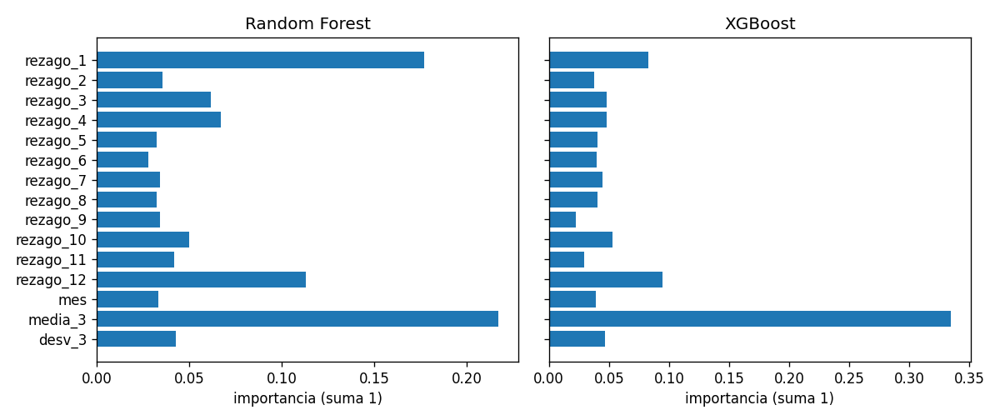
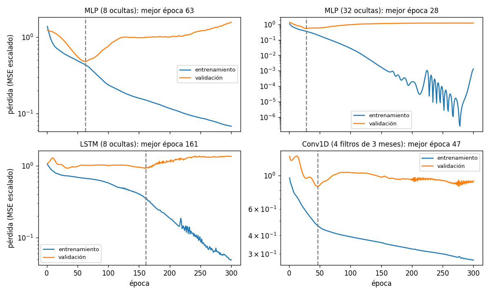

# Informe del miniproyecto 2

## 1. La serie y el modelo a superar

La serie es la del miniproyecto 1: la carga eléctrica media por hora de cada
mes en la zona de American Electric Power (AEP), dentro de la red PJM de
Estados Unidos, en MW. Va de octubre de 2004 a julio de 2018, con 166 meses y
ningún hueco.

Agosto de 2018 se descartó al agregar las horas porque solo tenía 49, dos
días de un mes de 31. Borrar un mes tiene un costo: si estuviera en medio de
la serie, dos filas seguidas quedarían separadas por dos meses, el índice
dejaría de ser mensual y `shift(12)` ya no apuntaría al mismo mes del año
anterior. Aquí no pasa porque agosto de 2018 era el último mes: quitarlo
acorta la serie, pero los 166 meses que quedan van uno detrás de otro.
`preparar` lo comprueba comparando el índice con
`pd.date_range(inicio, periods=166, freq="MS")` y lanza un error si falta
algún mes. El guion imprime *"espaciado mensual: 166 meses seguidos, de
2004-10 a 2018-07, sin saltos"*. Si el mes incompleto hubiera quedado en
medio, lo correcto habría sido dejarlo vacío e interpolarlo, no borrarlo.

`preparar` repite la decisión del miniproyecto 1 sobre los atípicos: compara
cada mes con el promedio del mismo mes un año antes y un año después. Julio
de 2009 queda a −3,5 desviaciones (14 697 MW frente a 17 360) y es el único
que pasa de 3. Se conserva porque es demanda real, no un error de medición.

El modelo a superar es el $\text{SARIMA}(3, 0, 0)(0, 1, 1)_{12}$:

$$(1 - \phi_1 B - \phi_2 B^2 - \phi_3 B^3)(1 - B^{12})\,y_t = (1 + \Theta_1 B^{12})\,\varepsilon_t,$$

con $B^k y_t = y_{t-k}$. Es el que sale de la lectura de la ACF y la PACF del
miniproyecto 1. ADF dio $d = 0$ y $D = 1$. Después de `diff(12)`, la PACF
tiene picos en los rezagos 1 y 3, de ahí $p = 3$. En la parte estacional, la
ACF tiene un pico aislado en el rezago 12 (−0,27) y la PACF decae en 12, 24 y
36 (−0,32, −0,20 y −0,13), que es la forma de un MA estacional de orden 1:
$Q = 1$ y $P = 0$.

En el miniproyecto 1 la rejilla por AIC eligió $P = 1$, el
$\text{SARIMA}(3, 0, 0)(1, 1, 1)_{12}$, con AIC 335,85 frente a 339,89, y ese
fue el modelo de la tabla. La realimentación señaló que $P = 1$ no coincide
con nuestra propia lectura de la ACF. Aquí usamos el modelo de esa lectura.
No lo elegimos por su error de prueba: la lectura de la ACF es anterior al
*backtest* y es la misma que escribimos en el miniproyecto 1.

Con toda la serie, en GW, los coeficientes son $\phi_1 = 0{,}427$,
$\phi_2 = 0{,}046$, $\phi_3 = 0{,}241$ y $\Theta_1 = -0{,}765$, con AIC 339,89.
Se ajusta sobre la serie en GW (`ESCALA = 1000`) con la clase `ARIMA` de
`statsmodels`, y el pronóstico vuelve a MW. En este *backtest* da RMSE
753,50 MW, MAE 586,96 MW y MAPE 3,99 %; en el contraste del miniproyecto 1
había dado 753,51, 586,96 y 3,99. El guion también pasa por el *backtest* el
de $P = 1$, solo como contraste y fuera de `metricas.csv`: RMSE 770,98.

## 2. La tabla supervisada

Cada fila es un mes $t$ y tiene 15 columnas, todas con datos hasta $t-1$:

| Columna | Fórmula | Qué aporta |
|---|---|---|
| `rezago_k`, $k = 1, \dots, 12$ | $z_{t-k} = y_{t-k} - y_{t-k-12}$ | la diferencia interanual de hace $k$ meses; `rezago_12` es la del mismo mes del año anterior |
| `mes` | mes del calendario de $t$, de 1 a 12 | se conoce de antemano |
| `media_3` | $\tfrac{1}{3}(z_{t-1} + z_{t-2} + z_{t-3})$ | el nivel reciente, suavizado |
| `desv_3` | desviación estándar de $z_{t-1}, z_{t-2}, z_{t-3}$ | qué tan estable estuvo el último trimestre |

Las dos ventanas se calculan sobre `z.shift(1)`, la serie corrida un mes,
para que la fila $t$ nunca incluya $z_t$.

Los modelos aprenden la diferencia con el mismo mes del año anterior,
`OBJETIVO = "dif12"`:

$$z_t = y_t - y_{t-12}, \qquad \hat y_t = y_{t-12} + \hat z_t.$$

La razón es el miniproyecto 1: ADF no rechazó la raíz unitaria en la serie
original (valor p 0,0858) y sí en `diff(12)` (0,0016), y de ahí salieron
$d = 0$ y $D = 1$. Es la misma decisión del SARIMA y de los talleres 3 a 5.
De los 166 meses quedan 142 filas completas, desde 2006-10: 12 se pierden en
la diferencia y 12 en `rezago_12`.

`comprobar_sin_fuga` suma 1 000 GW a cada mes, de uno en uno, vuelve a armar
la tabla y verifica que la fila de ese mes no cambie. Si cambiara, lanzaría
`AssertionError`. El guion imprime *"sin fuga: 166 meses alterados de uno en
uno y ninguna fila cambió"*.

El pronóstico a 12 meses es recursivo. En cada paso, `recursivo` agrega el
mes siguiente como vacío, arma su fila con los datos hasta el mes anterior,
pronostica $\hat z$, lo pasa a nivel con $\hat y_t = y_{t-12} + \hat z_t$ y
lo escribe en la serie como si fuera dato. Así, el pronóstico del mes 1 entra
como `rezago_1` del mes 2, y así hasta el 12. `con_tabla` lo envuelve para el
*backtest*: en cada origen divide el entrenamiento por `ESCALA`, arma la
tabla solo con esos meses, crea un modelo nuevo con la fábrica, lo ajusta y
multiplica el pronóstico por `ESCALA`. El `StandardScaler` de KNN y SVR va
dentro del `make_pipeline` y el de las redes dentro de `Red.fit`, así que en
cada origen se ajustan solo con el entrenamiento de ese origen.

## 3. Aprendizaje automático

{{La rejilla de cada modelo, con qué datos y con qué validación temporal se
eligió, y los hiperparámetros elegidos con su RMSE de validación. Por qué
ninguno de los meses del *backtest* participa en la elección.}}

{{Qué variables pesan más en Random Forest y en XGBoost, y si coinciden con
los rezagos que marcaba la PACF en el miniproyecto 1.}}

{{RMSE, MAE y MAPE de los cuatro modelos y cuál gana entre ellos.}}

## 4. Aprendizaje profundo

{{Las tres redes: arquitectura, número de parámetros y cómo recibe cada una
la entrada (columnas sueltas o secuencia). Cuál es la tercera red y por qué
la eligió el grupo.}}

{{Lectura de las curvas: dónde empieza el sobreajuste, cuántas épocas se
eligieron para cada red y qué tamaño de MLP quedó.}}

{{La mejor red con cinco semillas: el RMSE de cada una, la media y la
desviación. Si la diferencia con el clásico es mayor o menor que esa
desviación.}}

## 5. La tabla y la elección

{{Copie aquí `resultados/metricas.csv` como tabla de Markdown, ordenada por
RMSE.}}

| Modelo | RMSE | MAE | MAPE (%) | Parámetros | Segundos |
|---|---|---|---|---|---|
| {{...}} | {{...}} | {{...}} | {{...}} | {{...}} | {{...}} |

{{Si alguna red no supera al clásico, a qué lo atribuye el grupo y qué dato
de la serie lo muestra: el número de meses frente al número de parámetros,
el mes en que falla, la curva de pérdida o la variación entre semillas.}}

## 6. Conclusión

{{El modelo que el grupo pondría en uso y lo que se paga por él frente al
clásico: cuántos datos necesita, cuánto tarda en el *backtest* y qué tanto
se puede explicar su pronóstico.}}
